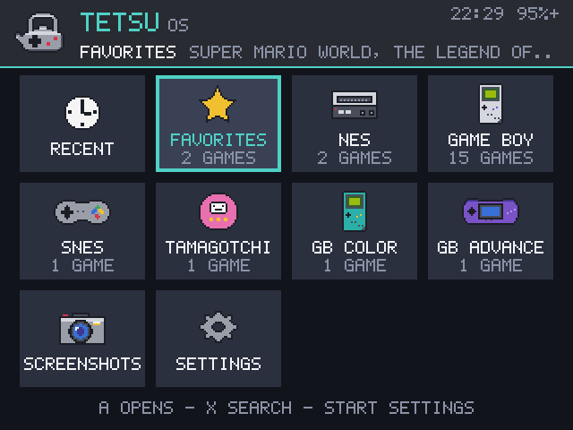
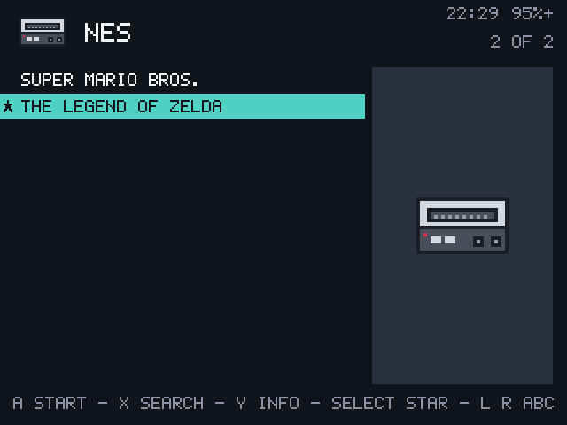
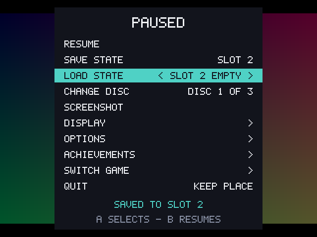
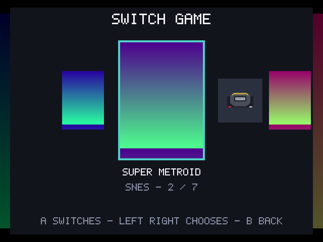

<p align="center">
  
</p>

<h1 align="center">Tetsu OS</h1>

<p align="center">
  A small, fast Linux system for retro handhelds, with its own game launcher.<br>
  Runs on the <b>Anbernic RG35XX SP</b>.
</p>

<p align="center">
  <a href="https://identity4.github.io/TetsuOS/"></a>
  <a href="https://github.com/iDentitY4/TetsuOS/releases"></a>
  <a href="LICENSE"></a>
</p>

<p align="center">
  <a href="https://identity4.github.io/TetsuOS/"><b>Documentation</b></a> ·
  <a href="https://identity4.github.io/TetsuOS/guide/installation">Installation</a> ·
  <a href="https://identity4.github.io/TetsuOS/reference/systems">Supported systems</a> ·
  <a href="https://github.com/iDentitY4/TetsuOS/releases">Download</a>
</p>

Tetsu OS boots straight into a launcher written from scratch in Rust, with a built-in
libretro frontend for the emulators: no RetroArch, no desktop, just your games a few
seconds after pressing power. *Tetsu* (鉄) is Japanese for iron, and the logo is an iron
kettle.

| | |
| --- | --- |
|  |  |
|  |  |

## Features

- **Fast start.** The launcher is up 3.8 seconds after pressing power, or 6.4 with the boot
  jingle and its animation.
- **25 consoles**, from the Atari 2600 and NES to the Game Boy Advance and PlayStation,
  plus Doom (Freedoom) and Cave Story ready to play. [All systems](https://identity4.github.io/TetsuOS/reference/systems)
- **Resume everywhere.** Quitting, closing the lid, switching games or a power cut bring
  you back to the same spot.
- **A full in-game menu:** save slots, CRT and LCD effects and bezels, button remapping
  and turbo, core options, cheats, screenshots and a game switcher.
- **RetroAchievements**, with unlock notices, hardcore mode and offline unlocks.
- **A launcher made for a small screen:** recent games, favorites, collections, box art,
  search and play statistics.
- **Wi-Fi and Bluetooth:** send games from a browser, download covers and cheats, back up
  saves with Syncthing, use Bluetooth controllers and headphones.
- **Careful power handling:** lid sleep, a charging screen, a battery log with time left
  and a charge limit.
- **Safe updates** over Wi-Fi into a second system slot, with an automatic fall back if
  the new one doesn't start.
- **English and German.**

The [user guide](https://identity4.github.io/TetsuOS/guide/) covers each of these.

## Getting started

You need an RG35XX SP, a spare microSD card of at least 6 GB (16 GB or more leaves room for
games) and a computer with a card reader. Tetsu OS runs from the card and leaves the
device's own firmware alone: take the card out and the stock system starts as before.

1. **Download** the card image for your device: the
   [image picker](https://identity4.github.io/TetsuOS/#download) names the right file, or
   take `tetsu-<device>-<version>-sdcard.img.gz` from
   [Releases](https://github.com/iDentitY4/TetsuOS/releases/latest). Since v0.2 it starts
   on RG35XX SP units with either memory type, LPDDR3 or LPDDR4.
2. **Write it to the card** with [balenaEtcher](https://etcher.balena.io) or
   [Raspberry Pi Imager](https://www.raspberrypi.com/software/) ("Use custom"). This
   erases the card.
3. **Boot.** Put the card in the **TF1** slot and press power. A short setup asks for the
   language, Wi-Fi and time zone.
4. **Add games.** Copy them to the `roms` folder of the card's **TETSU-DATA** drive:
   connect the USB cable and open Settings > SYSTEM > USB STORAGE, use WI-FI TRANSFER
   from a browser, or put the card in your computer.
   [Adding games](https://identity4.github.io/TetsuOS/guide/adding-games)

In the menus, **A** opens, **B** goes back and **Start** opens Settings. In a game, tap
**Menu** for the in-game menu, hold **R2** to fast-forward and press **Menu + Start** to
leave. More in [Controls](https://identity4.github.io/TetsuOS/guide/controls).

Something not working? See [Troubleshooting](https://identity4.github.io/TetsuOS/guide/troubleshooting)
and the [FAQ](https://identity4.github.io/TetsuOS/guide/faq).

## Status

Tetsu OS is in **beta** and developed on a single LPDDR3 RG35XX SP. Most features are
checked on that unit, but expect rough edges. Since v0.2 it also starts on LPDDR4
units; one tester's LPDDR4 SP ran v0.2-test.2 with games, sound, headphones, sleep, Wi-Fi
and the power button working ([#18](https://github.com/iDentitY4/TetsuOS/issues/18)). More reports help:
[help test](https://identity4.github.io/TetsuOS/guide/testing).
[CHANGELOG.md](CHANGELOG.md) lists what each release brings. USB accessories don't work
yet, as the USB-C port runs in device mode only. Since v0.2 there are also images for
the RG35XX Plus, H, 2024 and Pro, the RG40XX H and V, the RG34XX and RG34XX-SP and the RG
CubeXX, all untested so far
([requirements](https://identity4.github.io/TetsuOS/guide/requirements#the-device)); the
RG28XX is not supported yet.

## Building from source

Tetsu OS is a [Buildroot](https://buildroot.org) external tree with a mainline Linux kernel
and U-Boot. On Linux:

```sh
git clone https://github.com/iDentitY4/TetsuOS.git
cd TetsuOS
make        # the first build also makes a cross toolchain, so it takes a while
scripts/flash.sh /dev/sdX   # or write output/images/sdcard.img with any image writer
```

The [developer guide](https://identity4.github.io/TetsuOS/developer/) covers the build,
updating the device over USB, the boot process, the launcher's code and the hardware notes.

## Contributing

Issues and pull requests are welcome. Translations and testing on other RG35XX SP units
help most. See [CONTRIBUTING.md](CONTRIBUTING.md) before opening a pull request, and the
[Code of Conduct](CODE_OF_CONDUCT.md). Report security problems privately, as
[SECURITY.md](SECURITY.md) describes.

## Credits

Tetsu OS stands on a lot of other people's work:

- [Buildroot](https://buildroot.org), [Linux](https://kernel.org),
  [U-Boot](https://u-boot.org) and [Trusted Firmware-A](https://www.trustedfirmware.org)
- [ROCKNIX](https://github.com/ROCKNIX/distribution), whose H700 kernel patches drive the
  display and backlight
- The [libretro](https://www.libretro.com) emulator cores: FCEUmm, Snes9x, mGBA, PCSX
  ReARMed, Genesis Plus GX, PicoDrive, Beetle PCE Fast, NeoPop, Cygne and VB, Handy,
  Stella, ProSystem, vecx, PokeMini, Potator, Arduous, tamalib, PrBoom and NXEngine
- [Freedoom](https://freedoom.github.io) and Studio Pixel's Cave Story
- [rcheevos](https://github.com/RetroAchievements/rcheevos) and
  [RetroAchievements](https://retroachievements.org),
  [libretro-thumbnails](https://github.com/libretro-thumbnails) for box art,
  [Syncthing](https://syncthing.net), BlueZ and bluez-alsa

## License

Tetsu OS's own code (the launcher, scripts, Buildroot packages and board files) is under
the [MIT license](LICENSE). The kernel and BlueZ patches in `board/h700/patches/` are
under GPL-2.0, like the code they change. The emulator cores are downloaded at build time
under their own licenses, some of which forbid commercial use.

Tetsu OS is not affiliated with Anbernic. It comes with no games apart from the free ones
named above: bring your own.
